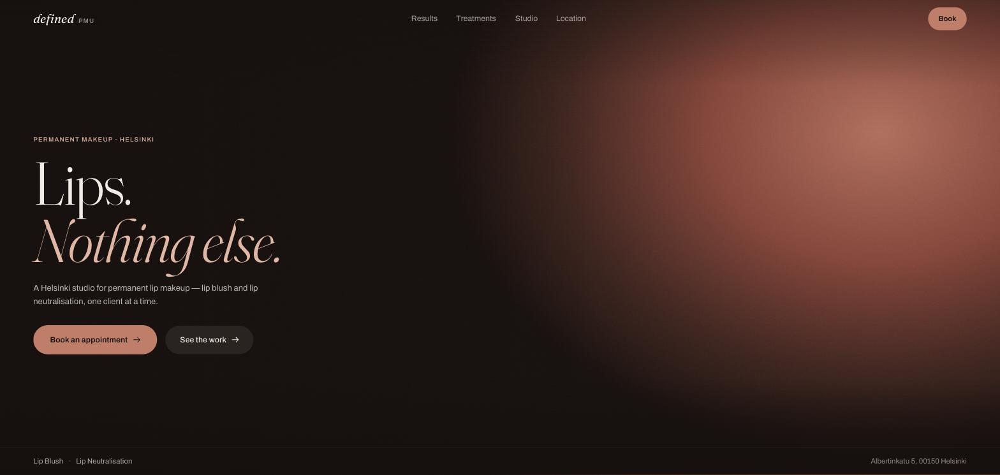
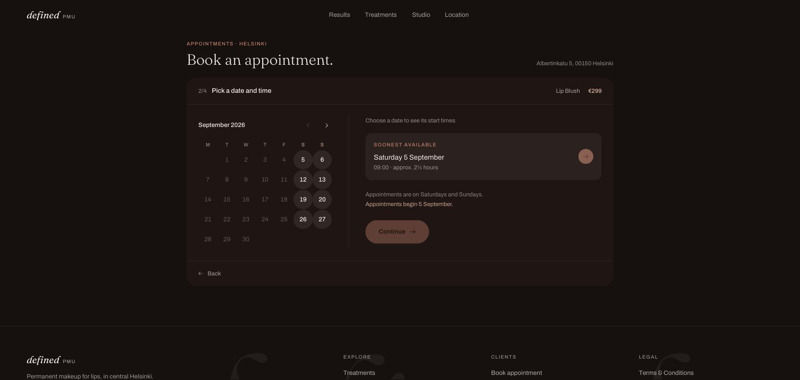
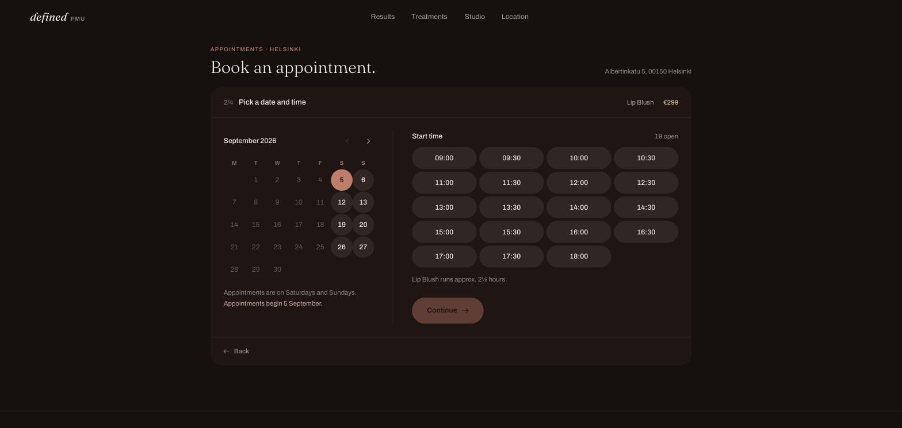
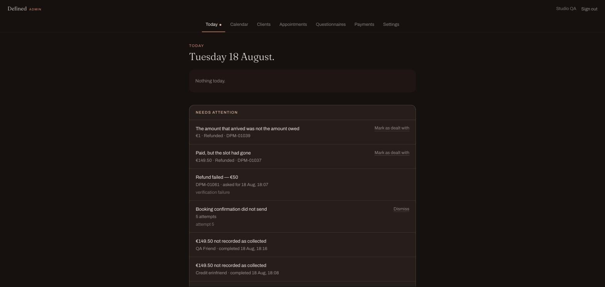
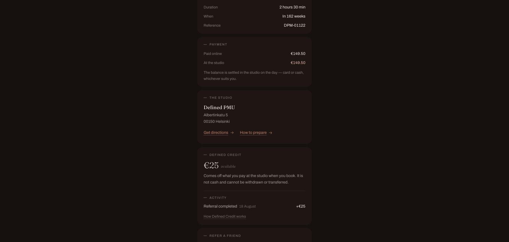

# Defined PMU

Defined PMU is a production booking and studio-operations platform built for a
permanent makeup studio in Helsinki. It handles real-time scheduling, online
deposit payments, secure client intake, practitioner operations, lifecycle
communication and a referral credit system. It is live and takes real
customer payments.

**Live product:** https://definedpmu.com

**Production source:** private

**This repository:** a sanitized engineering case study. It contains no
production source code, no configuration and no customer data.

---

## Stack

Verified from the production repository:

| Layer | What is used |
| --- | --- |
| Application | Next.js 16 (App Router), React 19, TypeScript |
| Styling | Tailwind CSS v4, no component framework |
| Database | PostgreSQL on Supabase |
| Payments | Stripe (PaymentIntents, signed webhooks) |
| Email | Resend, behind a database-backed outbox |
| Hosting | Vercel, including a daily cron for the lifecycle worker |
| Maps | MapLibre GL with self-hosted PMTiles |

Server code talks to PostgreSQL through a small set of `SECURITY DEFINER`
functions. The browser never talks to the database.

---

## What the system does

**Customer site.** Treatments, pricing, studio information, an interactive
self-hosted Helsinki map, legal and care pages, and the booking flow.

**Booking engine.** Live availability read from PostgreSQL per request,
per-service durations and buffers, operating-day rules, a minimum notice
window and short-lived server-side checkout holds. Two PostgreSQL exclusion
constraints decide whether a slot was free.

**Payments.** A 50 percent deposit is taken online through Stripe; the balance
is settled at the studio. Prices are derived on the server and the browser
cannot name an amount. A booking becomes real only when a signed Stripe
webhook says the money arrived.

**Client intake.** A health questionnaire opened from a capability link in the
confirmation email. Answers live in their own table, read by exactly one
database function, and never reach a URL, a log, an email or Stripe.

**Practitioner admin.** Today view, week calendar, client directory,
appointment detail, payment state, questionnaire review, private notes,
treatment records, rescheduling, cancellation, refunds, studio balance
collection, completion, an audit trail and operational settings.

**Lifecycle automation.** Eight transactional messages derived from
authoritative appointment state, scheduled as durable jobs, delivered through
an idempotent outbox.

**Client Card and referral credit.** Each client gets a private page at a
capability URL, a stable referral identity with a QR code, and an append-only
credit ledger that grants 25 euro per completed referral.

---

## Engineering highlights

### Concurrency-safe scheduling

Checking availability and then inserting a row is unsafe: two requests can
both pass the check before either writes. In this system PostgreSQL is the
final authority. Two GiST exclusion constraints on the schedule table decide
the outcome, one preventing any active entry from overlapping another, and one
enforcing the reset time the studio needs between two different clients.
Bookings, live checkout holds and manual blocks all participate. Application
level checks exist for the customer's benefit, not as the guarantee.

[Details](docs/scheduling-and-payments.md)

### Server-authoritative payments

The browser sends an intent, never a price. The server reads the amount from
the booking snapshot it wrote a moment earlier, creates the PaymentIntent with
an idempotency key derived from the booking, and waits for a signed webhook.
The webhook verifies the signature against the raw request body before any
parsing, compares the received amount and currency against the booking's own
snapshot, and confirms atomically. If the slot went to somebody else while the
customer was paying, the payment is refunded rather than honoured, and the
exception is written down before the refund is requested.

[Details](docs/scheduling-and-payments.md)

### Secure client intake

Health answers are a special category under GDPR Article 9. They are stored in
a separate table that one database function reads, kept apart from the
operational booking and contact records, and excluded from the ordinary admin
appointment views. Access to the form is a capability: 256 bits of randomness
in the URL path, stored only as a digest, scoped to one booking's
questionnaire. The client needs no account.

[Details](docs/security-and-privacy.md)

### Durable lifecycle communication

Every scheduled message derives its due time from authoritative state
(confirmation, appointment start, or completion) rather than from a page being
opened. Jobs live in a table, the worker claims them with `FOR UPDATE SKIP
LOCKED`, and each job re-asks the authoritative questions in the second before
sending, so a cancelled appointment cannot be reminded about. Sending is a row
in an outbox with a unique deterministic key, so a retry or a duplicate webhook
delivery cannot produce a second email.

[Details](docs/lifecycle-and-credit.md)

### Defined Credit

A referral qualifies only when the practitioner marks the treatment completed,
written by a database trigger rather than by any application path. The reward
is 25 euro of credit that reduces the amount due at the studio and never the
deposit required online. There is no balance column anywhere: every figure is
a sum over an append-only ledger of grants, reservations, releases,
redemptions and adjustments. Reserving happens inside the same transaction as
the checkout hold and behind a per-customer advisory lock, so two browser tabs
cannot spend the same 25 euro. The browser sends one boolean, never an amount.

[Details](docs/lifecycle-and-credit.md)

---

## Testing and checks

Run against a local PostgreSQL stack and the Stripe sandbox on 18 August 2026:

| Suite | Checks |
| --- | --- |
| Scheduling rules | 112 |
| Booking engine | 94 |
| Payments | 134 |
| Email | 224 |
| Questionnaire | 127 |
| Admin | 246 |
| Lifecycle | 278 |
| Client Card and referrals | 191 |
| Consent | 72 |
| Defined Credit | 90 |
| **Total** | **1,568** |

All ten suites passed, alongside `tsc --noEmit`, ESLint and a Next.js
production build.

These are behavioural checks executed by custom runners, not unit tests in a
framework. The payment suite creates real PaymentIntents, charges and refunds
in the Stripe sandbox and refuses to start against a live key or a non-local
database.

[What the suites actually cover](docs/testing-and-reliability.md)

---

## Documentation

| Document | Contents |
| --- | --- |
| [Architecture](docs/architecture.md) | System shape, request paths, diagrams |
| [Scheduling and payments](docs/scheduling-and-payments.md) | Overlap prevention, holds, Stripe flow, failure paths |
| [Security and privacy](docs/security-and-privacy.md) | Capability links, health data separation, consent, headers |
| [Lifecycle and credit](docs/lifecycle-and-credit.md) | Job engine, outbox, referral qualification, credit ledger |
| [Testing and reliability](docs/testing-and-reliability.md) | Suite by suite coverage |
| [Production lessons](docs/production-lessons.md) | Real incidents and what they changed |

---

## Screenshots

**Homepage**

**Booking, live availability read from PostgreSQL**

**Practitioner admin, the operational queue**

**Client Card, referral credit**

The public screenshots are the live site. The admin and Client Card
screenshots were taken against a local database seeded by the project's own QA
script, which creates synthetic clients with `example.test` addresses and
appointments dated far beyond anything the studio has sold. No real client
data, no real appointment and no real token appears anywhere in this
repository.

## My role

I am [Magnus Kaur](https://magnus.is-a.dev), a software developer in Helsinki.
Defined PMU is my work as the sole developer on the project.

I owned the product requirements, the business rules, the architecture
decisions, the implementation direction, the review of behaviour and code, the
test suites, the debugging, the deployment and the production verification.

Development agents (Claude Code and ChatGPT) accelerated the implementation.
They wrote code under direction; deciding what the system had to do, whether
what came back satisfied the studio's rules, and whether it worked correctly
against a real database, a real Stripe account and a real domain, remained
mine. The production incidents in
[docs/production-lessons.md](docs/production-lessons.md) are the part of the
work no agent could do on its own.

---

## What this repository deliberately does not contain

No production source, no schema dumps, no migrations, no environment values,
no infrastructure identifiers, no customer data, and no screenshots of real
appointments. The technical documents here describe design decisions and
reasoning at the level a reader needs to judge the engineering, and no lower.
