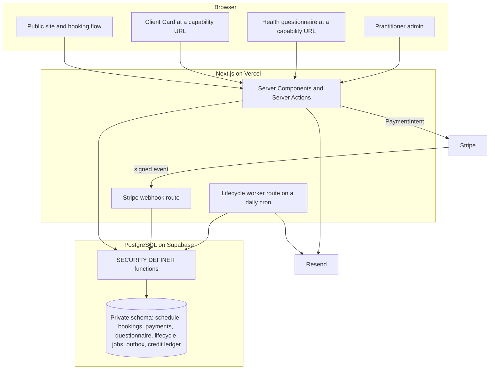
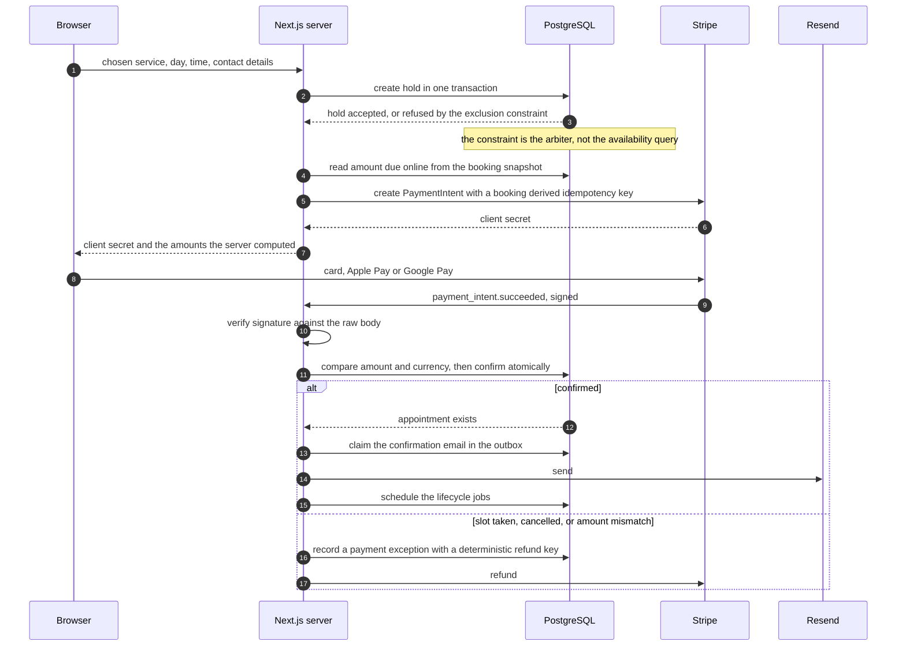
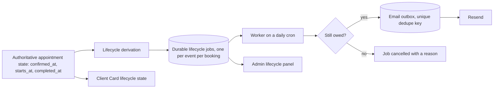
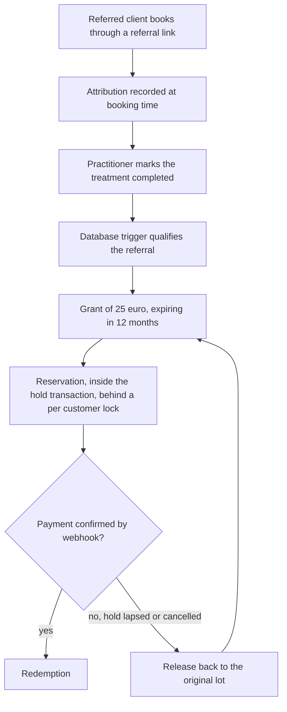

# Architecture

## Shape

Defined PMU is one Next.js App Router application deployed on Vercel, talking
to a PostgreSQL database on Supabase, Stripe for money and Resend for email.
There is no separate API service and no client-side data layer.

Three properties define the shape more than anything else:

1. **The database is the authority.** Slot conflicts, payment confirmation,
   referral qualification and credit balances are all decided in PostgreSQL,
   not in application code. Application checks exist so the customer sees a
   useful message, not so the invariant holds.

2. **The browser holds no privilege.** One module knows Supabase exists. It is
   marked `server-only`. Business tables live in a schema no role has
   privileges on, and the entire API is a small set of `SECURITY DEFINER`
   functions callable by the service role alone. The publishable Supabase key
   in the client bundle can read nothing.

3. **Private surfaces are capabilities, not accounts.** Customers never create
   an account. A questionnaire link and a Client Card link each carry 256 bits
   of randomness in the URL path, stored server-side only as a SHA-256 digest,
   scoped and revocable.

## Booking and payment flow

The important detail is what does not confirm a booking. Selecting a time
confirms nothing. Paying in the browser confirms nothing. The signed webhook
is the only thing that turns a hold into an appointment.

An abandoned checkout stops occupying the calendar the moment its hold expiry
passes, whether or not any cleanup job has run, because the exclusion
constraints only consider entries that are still held or confirmed. A separate
sweep cancels the Stripe PaymentIntents whose holds lapsed, so an abandoned tab
cannot be paid a week later.

## Lifecycle flow

The same derivation feeds three surfaces: the emails, the Client Card and the
admin views. There is one function that answers "where is this client in her
healing, and when does her top-up window open", and everything reads it.

## Defined Credit flow

Every line is an append-only ledger entry. There is no balance column to drift.
Released credit returns to the lot it came from with that lot's original
expiry, so booking and cancelling repeatedly cannot refresh credit that was
about to expire.

## Why these boundaries

**One module owns the database.** Every other file asks it for a typed result.
This is what makes "the browser cannot reach the database" a structural fact
rather than a convention.

**One module owns Stripe.** It reads the secret key, creates intents, verifies
events and issues refunds. Nothing else imports the Stripe SDK.

**One module owns token minting.** Both capability schemes call the same digest
helper, because two hashing implementations eventually disagree about what a
digest is.

**One module owns money formatting and the deposit split.** The split is
computed by the database and rendered in one place, so the booking page, the
confirmation email, the Client Card and the admin panel cannot show different
numbers.
